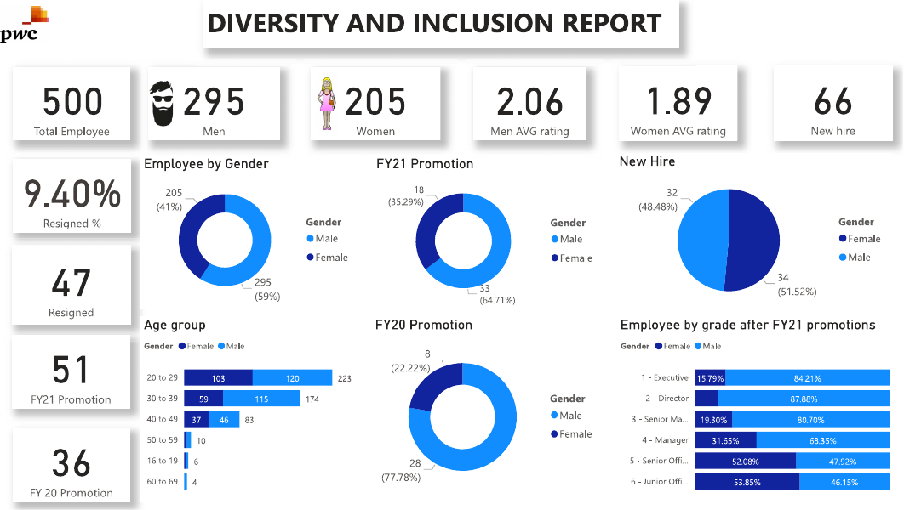
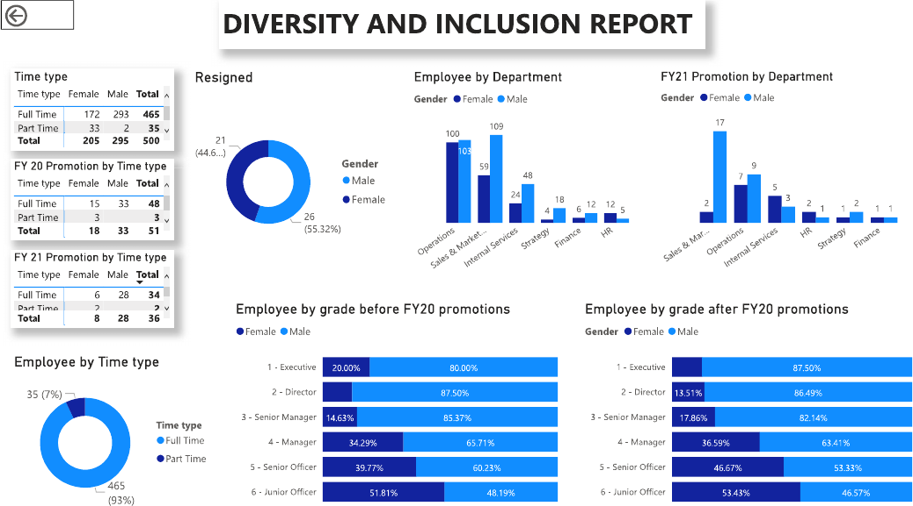

# Gender Diversity and Inclusion Analysis (PwC Switzerland Virtual Experience)

**Tools:** Power BI · **Program:** PwC Switzerland Power BI virtual experience, delivered through Forage · **Data:** HR records for 500 employees of a fictional company, FY2020 and FY2021

## Business question

The HR leadership team wanted to know whether the company was making progress on **gender balance** across hiring, promotion, performance ratings and turnover, and where to focus next.

## What I did

* Prepared and modelled the HR data in Power BI
* Built measures for headcount, hires, promotions, resignations, turnover rate and average performance rating, split by gender, age group and job level
* Designed a dashboard covering hiring, promotion, turnover and performance

## Key findings

| Area | Finding |
|---|---|
| Workforce | 500 employees: **295 men (59%) and 205 women (41%)** |
| Performance ratings | Men averaged **2.06**, women **1.89**, a gap worth reviewing for bias |
| Promotions | Rose from **36 in FY2020 to 51 in FY2021**; the female share improved from **22% to 35%** |
| New hires | **66** hires, **52% women**: balanced recruitment |
| Turnover | **47 resignations (9.4%)**: 55% men, 45% women |
| Part time roles | **35** part time employees (7%), of whom **94% are women** (33 of 35) |

## Recommendations

1. **Review the performance rating process** for consistency between men and women.
2. **Keep the promotion trend going**, with clear criteria and tracking by gender.
3. **Understand the part time imbalance:** check whether part time roles limit career progression, and offer flexible work to all.
4. **Run exit interviews** to understand resignation drivers.

## Files

| File | Contents |
|---|---|
| `DIVERSITY AND INCLUSION REPORT.pdf` | Dashboard pages |
| `images/` | Dashboard images |
